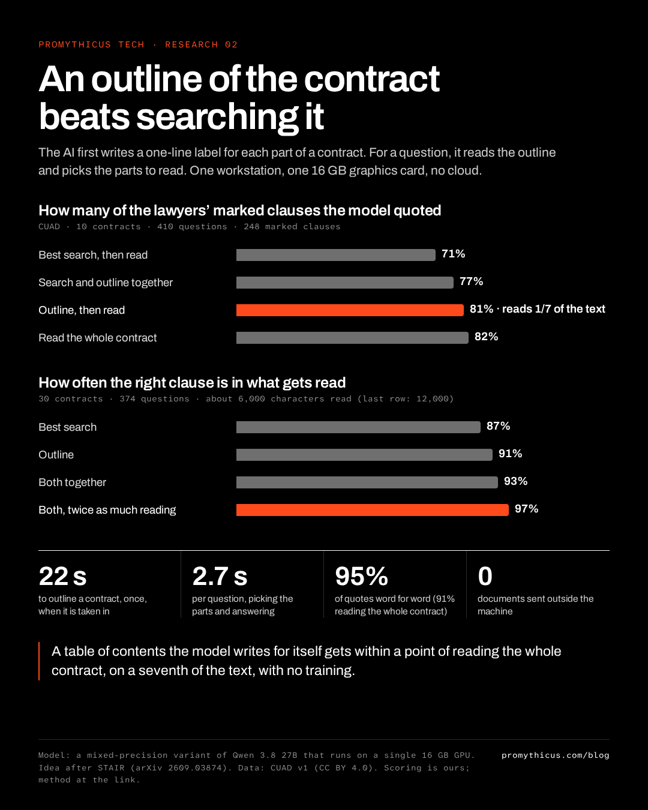

# 02. Routing by an outline of the contract

**Promythicus Tech research.** Write-up for a general reader: [promythicus.com/blog/contract-outline-beats-search-local-ai-test/](https://promythicus.com/blog/contract-outline-beats-search-local-ai-test/)

Started 2026-11-15, from our pointer to STAIR (arXiv 2609.03874): a language model is given
a book's table of contents with the question and names the section to read.

**Why not the paper's method as published.** It fine-tunes the model on each corpus and needs a real
table of contents; CUAD contracts mostly have none (half have fewer than five detectable headings).

**What is tested instead (no training).** The model writes a one-line label for each 1,500-character
part of a contract (an induced outline); for a question it is shown the outline and names the parts
to read. Compared, at the same reading budgets as experiment 01, with that experiment's best search
(500-character passages, Qwen3-Embedding-0.6B, Qwen3-Reranker-0.6B), alone and combined.

**Data.** CUAD v1 test split from `../cuad-retrieval/data`; a fixed sample of 30 of the 102
contracts (seed 7), every question that has an answer.

**Files.** `outline.py` (label / route, needs the model on :8081), `evalr.py` (scores), `run.sh`, `out/`.

Model named in public only as in experiment 01's README.

## Results (2026-11-15)

**Retrieval only** (`evalr.py`, `out/scores.json`; 30 contracts, 374 questions with an answer, 820 marked
clauses). hit = a part of an answer is in what is read; span = share of marked clauses in what is read.

| What is read | hit 6k | span 6k | hit 12k | span 12k |
|---|---|---|---|---|
| best search of experiment 01 | 86.6 | 69.8 | 93.3 | 81.0 |
| outline: the parts the model names (4 / 8 parts of 1,500) | 90.9 | 81.5 | 93.9 | 86.3 |
| search inside the named parts only | 89.8 | 77.9 | 93.3 | 86.0 |
| search and outline fused (RRF) | 92.8 | 81.1 | 96.5 | 89.5 |
| search over passages with their label in front | 87.4 | 75.4 | 93.6 | 84.0 |
| the same, fused with the outline | 92.5 | 81.2 | 96.0 | 88.4 |

Labelling the 1,318 parts took 1,255 s (about 42 s a contract, once); naming the parts 1.32 s a question
(6.6 parts named on average).

**End to end** (`e2e.py`, `out/e2e_scores.json`; experiment 01's ten pilot contracts, 410 questions, 248
marked clauses, same model, same scoring). Rows marked 01 are that experiment's.

| Way of reading | right passage read | clauses quoted | "is there such a clause" F1 | quotes word for word | tokens read | s/question |
|---|---|---|---|---|---|---|
| 01: best search, 12 short passages | 92.7 | 70.6 | 74.0 | 98.1 | 1,187 | 3.1 |
| 01: best search, 24 short passages | 95.1 | 73.4 | 73.5 | 95.1 | 2,285 | 3.7 |
| search and outline fused, 12 short passages | 95.1 | 77.0 | 73.5 | 94.8 | 1,236 | 3.3 + 1.3 |
| search and outline fused, 24 short passages | 96.7 | 77.0 | 74.8 | 93.1 | 2,303 | 4.1 + 1.3 |
| **outline, 4 parts** | 95.1 | **80.6** | 74.8 | 94.9 | 1,203 | 3.0 + 1.3 |
| **outline, 8 parts** | 97.6 | **81.9** | 77.0 | 94.0 | 2,055 | 3.6 + 1.3 |
| 01: whole contract | 100 | 82.3 | 76.9 | 90.5 | 8,374 | 3.3 (8.3 first question) |

"+ 1.3" is the model naming the parts (1.27 s a question; it named at least one part for all 410).
Labelling the ten contracts (324 parts) took 308 s, about 31 s a contract, once.

**Read of it.** An outline the model writes itself, with no training, nearly closes the gap to reading
the whole contract (81% and 82% of clauses against 82%) while reading a seventh to a quarter of the
text; the best search stood at 71% and 73%. Fusing with the search found the right passage slightly
more often but quoted fewer clauses than the outline alone (77%): the outline reads whole 1,500-character
parts in the contract's order, the fusion reads 500-character pieces.

**Costs.** About half a minute of model time per contract when it is taken in (the search index took
0.24 s a contract), and 1.3 s more per question.

**Limits.** Ten contracts end to end, thirty for retrieval. The paper's own method (fine-tuning) was
not run. The outline was tested inside one contract; across a collection something must first pick
the documents, which was not tested. Part size (1,500) and label length were not tuned. Scoring is ours.

## Speed (2026-11-16)

Can the outline be made faster? `speed.py`, `speed.sh`, `speed2.sh`; raw results `out/sp_*`, summary `out/speed.json`.
Same ten contracts, 410 questions, 4 parts read. Servers started by hand on :8082.

| Setting | outline, s/contract | pick, s/question | answer, s/question | clauses quoted | quotes word for word |
|---|---|---|---|---|---|
| first run (labels one at a time, up to 8 parts named) | 30.8 | 1.27 | 2.98 | 80.6 | 94.9 |
| at most 4 parts named | 30.8 | 1.00 | 3.02 | 82.3 | 94.6 |
| the same on the server's fast setting (MTP, drafts of 2) | 30.8 | 0.77 | 1.86 | 81.9 | 94.8 |
| labels written 8 at once (`-np 8`), 4 parts, fast setting | 21.9 | 0.78 | 1.88 | 81.9 | 95.1 |
| labels by a small model (Qwen3-4B-Instruct Q4_K_M, 8 at once), 4 parts | 2.9 | 1.00 | 2.94 | 71.8 | 97.3 |

Labels 4 at once: 23.0 s a contract. Written in parallel, 106 of the 324 labels differ in wording from the
first run (batched arithmetic), with no effect on the score. With the small model's labels the right part
was read for 87.8% of questions against 95.1%.

**Read of it.** A question goes from 4.3 s to 2.7 s (pick + answer) with the same accuracy; the outline
from 31 s to 22 s a contract. Parallel requests gave only 1.4 times: one request already uses most of
the card. A small model writes the outline ten times faster but its labels lose the gain over search.
Not tested: the search methods on the fast setting (they would gain on the answer too); a mid-size
model for the labels; the small model beside the large one on one 16 GB card (it would not fit, so
labelling with it would be a separate batch).

**Published from it** (`publish/`): `infographic.png`, `infographic-fr.png`, `linkedin.txt`, `x.txt` (kept
for later). Article in the site repo, `posts_research.py`, key `research02`.

## Running it

- Everything ran on one workstation with one 16 GB NVIDIA graphics card and no cloud service.
- The larger model is named only as **a mixed-precision variant of Qwen 3.8 27B that runs on a single 16 GB GPU**. Scripts take its file from the environment:
  `export MODEL_GGUF=/path/to/your/model.gguf`. The small models are the public releases.
- Datasets and models are not in this repository; the write-up says where they come from.
- Large raw outputs (model states, patches) are left out; the scripts regenerate them.

One run of each, our own scoring: these numbers cannot be set beside published benchmarks. Corrections are welcome:
root@promythicus.com. More experiments: [github.com/Promythicus](https://github.com/Promythicus) ·
[promythicus.com/blog](https://promythicus.com/blog/)
